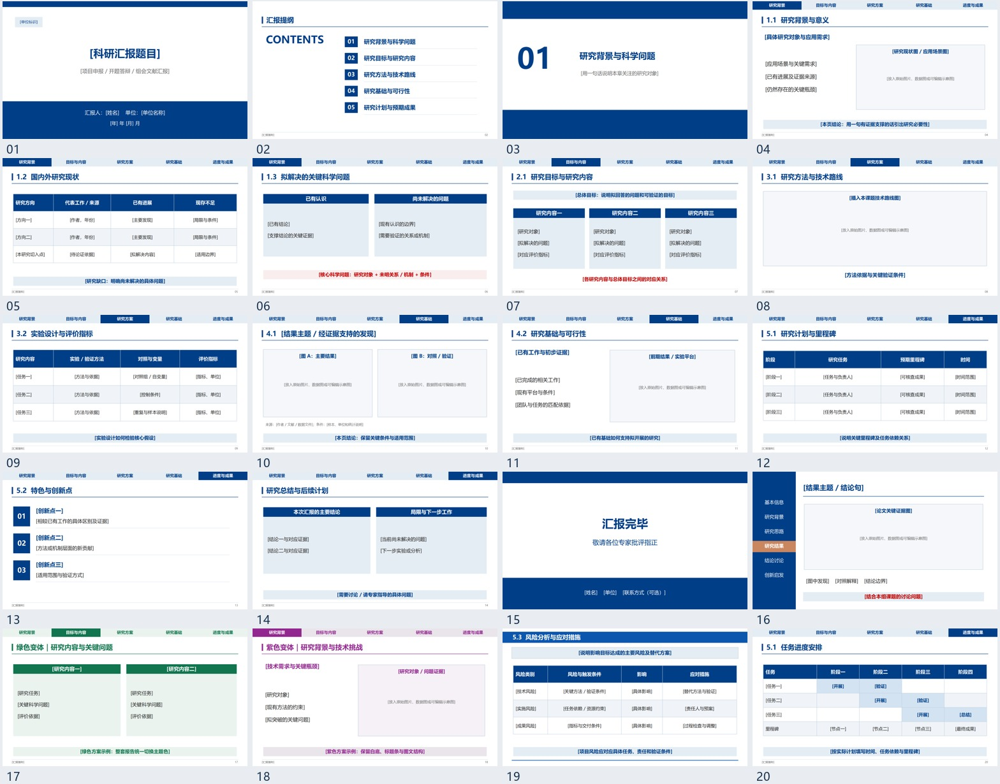

# Science PPT Skill · 科研汇报模板

一套根据 14 份科研汇报 PPT、297 页内容提炼的 Codex skill。以中文科研汇报的常用版式为基础，制作可编辑的 `.pptx`，适用于文献组会、开题答辩、基金申报、重点研发与结题汇报。

技能名称：`artifact-template-research-ppt`。



## 包含什么

- 蓝、绿、紫三类配色，以及项目标题栏、顶部导航、海军蓝左侧导航。
- 20 页可编辑版式目录，包含背景、科学问题、研究内容、技术路线图位、实验结果、创新、进度与风险表。
- 科研汇报设计规范、按场景组织内容的指南、原件来源索引和样本视觉参考。
- 事实与来源约束：保留论文证据，区分已有结果与研究计划，不编造数据或引用。

20 页是可供选择和复用的版式目录，不是每次汇报的固定页数。

## 安装到 Codex

在 Codex 中使用已安装的 `skill-installer`，发送：

```text
使用 skill-installer，从这个地址安装科研PPT技能：
https://github.com/kangqing2024/science-ppt-skill/tree/main/artifact-template-research-ppt
```

也可以下载或克隆本仓库，将完整的 `artifact-template-research-ppt` 文件夹复制到个人技能目录：

- Windows：`%USERPROFILE%\.codex\skills\`
- macOS / Linux：`~/.codex/skills/`
- 设置了 `CODEX_HOME` 时：使用其中的 `skills/` 目录。

保留文件夹中的 `SKILL.md`、`agents/`、`assets/`、`references/` 和 `artifact-template.json`。如果同名技能已经存在，先比较版本再更新，不要直接覆盖。安装后在下一轮对话中调用。

## 使用

附上论文或项目资料，然后发送：

```text
用 $artifact-template-research-ppt，把这篇论文制作成15页中文组会汇报，采用海军蓝左侧导航。
```

```text
用 $artifact-template-research-ppt，制作开题答辩PPT，采用浙大蓝、顶部导航，方法图保留可编辑Visio源文件。
```

```text
用 $artifact-template-research-ppt，把这些资料整理成绿色基金申报答辩PPT，重点讲科学问题、研究内容和技术路线。
```

本技能定义设计与叙事规则，实际制作需要可读写 PPTX 的工具；有 Presentations 工具时可直接配合使用。新绘制的科研方法、模型和架构图默认使用 Visio 并保留 `.vsdx`；统计图不受此限制。没有 Visio 的环境可先复用论文原图，或按用户选择的工具制作并说明源文件格式。

## 模板与说明

- [下载可编辑 PPT 原型](artifact-template-research-ppt/assets/reference.pptx)
- [设计规范](artifact-template-research-ppt/references/design-system.md)
- [场景叙事](artifact-template-research-ppt/references/scenarios.md)
- [版式目录](artifact-template-research-ppt/references/slide-catalog.md)
- [技能入口](artifact-template-research-ppt/SKILL.md)

原型的主要对象位于幻灯片层，适合复制页面后编辑；它不是 20 个不同母版的 POTX。

## 来源与素材

设计归纳来自用户提供的科研模板样本，原始 14 份 PPT 未随仓库分发。来源索引保留文件名、页码和哈希，不包含本机路径。样本视觉参考图中的第三方校徽、科研图及页面截图用于说明设计来源，相关权利归原作者；使用它们时应保留适当署名并遵守各自授权。

方法参考：[ppt-master](https://github.com/hugohe3/ppt-master) 的设计参数与可编辑对象思路，以及 [nature-paper2ppt](https://github.com/Yuan1z0825/nature-skills) 的证据叙事、术语一致和渲染检查。技能主体以本地科研样本的设计归纳为准，不依赖下载这两个仓库。
